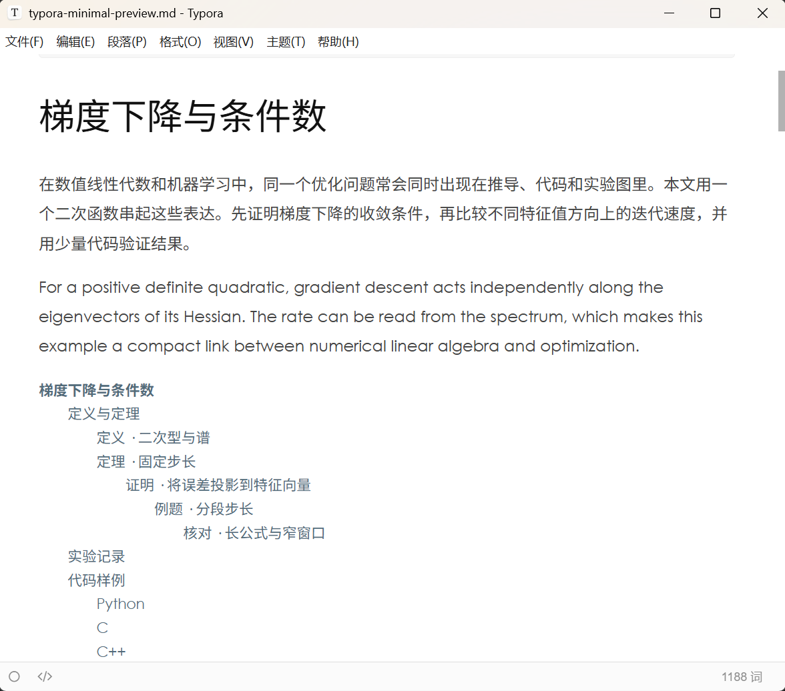

# Typora Minimal

Typora Minimal 是一款为数学笔记、技术文档和长文写作设计的浅色 Typora 1.x 主题。标题和正文共享几何无衬线字形，正文有 900 px 的最大内容宽度和 1.85 倍行距。标题默认左对齐，可单独将一级标题设为居中。



## 安装

1. 在 Typora 中打开「偏好设置 → 外观 → 打开主题文件夹」。Windows 上的默认位置是 `%APPDATA%\Typora\themes`。
2. 将 [typora-minimal.css](typora-minimal.css) 和 [typora-minimal](typora-minimal/) 资源目录放到同一级，保留其中的 `fonts/` 和 `licenses/`。
3. 重启 Typora，在「主题」菜单选择 **Typora Minimal**。
4. 打开 [preview.md](preview.md) 试排，保持 `preview-assets/` 与它同级。行内数学和高亮可在 Typora 的「偏好设置 → Markdown」启用。 [官方主题安装说明](https://theme.typora.io/doc/Install-Theme/) · [Markdown 参考](https://support.typora.io/Markdown-Reference/)

```text
typora-minimal.css
typora-minimal/
  fonts/      TeX Gyre Adventor 的四款 OTF
  licenses/   GFL、LPPL 1.3c 和上游清单
preview.md
preview-assets/
  quadratic.png
  editor.png
  typora-minimal-a4.pdf
README.md
LICENSE
```

## 设计依据

官网实际 CSS 优先使用 Century Gothic，其次使用 TeX Gyre Adventor。普通段落为 16 px，行高 28 px，段后距 20 px。基础 H1–H3 依次为 64、48、36 px。页首背景为 `#FBFBFB`，导航为白底配 `#EEEEEE` 分隔线，横幅副标题用 12 px 和 6 px 字距。 [官网](https://typora.io/) · [官网排版 CSS](https://typora.io/css/gothic.css) · [官网首页 CSS](https://typora.io/css/index.css?date=0424)

四张参考图共同呈现圆润的字形、清楚的字号层级、规律的留白和低饱和的导航选中状态。主题借用这些视觉特征，将 H1–H6 缩到 36、28、23、19、16、14 px，以适应文档里的多层标题。实际字号随 Typora 的字体大小设定缩放。

本地参考的官方 Gothic 主题也用 TeX Gyre Adventor，正文行高为 1.75 rem，基础写作区最大宽度为 914 px。Windows 主题实现对照了 Typora 1.14.17 安装中的文档容器、CodeMirror、公式、表格与侧栏选择器。 [Gothic 主题](https://theme.typora.io/theme/Gothic/) · [主题开发文档](https://theme.typora.io/doc/Write-Custom-Theme/)

| 用途 | 颜色 |
| --- | --- |
| 文档 / 次级背景 | `#FFFFFF` / `#FBFBFB` |
| 标题 / 正文 | `#111111` / `#444444` |
| 次级 / 辅助文字 | `#666666` / `#707070` |
| 链接、活动控件 | `#526B7A` |
| 警示标签 | `#B23B35` |
| 分隔线 / 悬停 / 选中 | `#EEEEEE` / `#F2F2F2` / `#DFE8EF` |
| 代码底色 | `#F7F7F7` |

## 字体

| 内容 | 字体顺序 |
| --- | --- |
| 英文标题与正文 | Century Gothic、随附的 TeX Gyre Adventor |
| 中文 | Noto Sans SC、Noto Sans CJK SC、微软雅黑 UI、微软雅黑、苹方 |
| 代码 | JetBrains Mono、Cascadia Mono、Consolas、系统等宽字体 |
| 数学 | Typora 自带 MathJax 的原生字形 |

英文字体可离线使用，其余字体来自本机。随附四款 OpenType 字体为 GUST 发布的原始 TeX Gyre Adventor 2.501，许可及清单在 [typora-minimal/licenses](typora-minimal/licenses/) 中。 [上游字体发布](https://www.gust.org.pl/projects/e-foundry/tex-gyre/adventor) · [GUST Font License](typora-minimal/licenses/GUST-FONT-LICENSE.txt) · [LPPL 1.3c](typora-minimal/licenses/LPPL-1.3c.txt)

## 自定义

在主题文件夹新建 `typora-minimal.user.css`。下例同时将正文扩宽至 960 px、微调行高并居中一级标题，可按需保留其中的设置。 [Typora 用户样式说明](https://support.typora.io/Add-Custom-CSS/)

```css
:root {
    --writing-width: 960px;
    --writing-line-height: 1.9;
    --h1-align: center;
}
```

## 打印和导出

- **PDF / 打印**使用 10.5 pt 正文、1.58 倍行距、最大 178 mm 版心和白色纸面。标题尽量与后文同页，长代码按纸宽折行。
- **带样式 HTML**可选择 Typora Minimal。迁移 HTML 时一并保留文档引用的图片等资源。
- **超宽公式**在纸面上仍受纸宽限制，可以用 `aligned` 将推导按等号断行，或在 PDF 导出设置中选择更宽的纸张。
- **Word 等 Pandoc 导出**的样式由各格式的导出设置和模板控制。 [Typora 导出文档](https://support.typora.io/Export/)

Typora 1.14.17 的普通 HTML 导出沿用系统字体栈。需要让导出的 HTML 随附 Adventor 时，可在「偏好设置 → 导出 → HTML → 在 `<head>` 中追加」填写下列标签，并将主题 CSS 和资源目录一起放在 HTML 旁边。 [HTML 自定义导出说明](https://support.typora.io/Export/#add-custom-contents)

```html
<link rel="stylesheet" href="./typora-minimal.css">
```

## 实机验证

在 Windows 的 Typora 1.14.17 中检查了正文编辑与撤销、源码模式、专注模式、打字机模式、文件树和大纲。样稿覆盖六级标题、中英文混排、行内公式、带编号的独立公式、矩阵与特殊数学字形，以及表格、Mermaid 和九种代码语言。宽屏版心实测为 900 px，窄窗下可横向滚动长公式。代码块实测支持行号、折行和横向滚动。

以四边 16 mm 的 A4 页面从 Typora 导出样稿，检查了公式编号、图片和图注、代码折行及分页。编辑区极窄时，Typora 的原生 GitHub 与 Minimal 都观察到了导出时的空代码块。恢复正常编辑宽度后，样稿中的十段代码在 PDF 和带样式 HTML 中完整导出。 [A4 PDF 样稿](preview-assets/typora-minimal-a4.pdf)

实机验证范围是 Windows Typora 1.14.17。macOS、Linux、Typora 2.x 和实体打印待验证。

## 许可证

主题代码和预览示例采用 [MIT 许可证](LICENSE)，版权署名 IniJyou。随附字体沿用上游许可。
