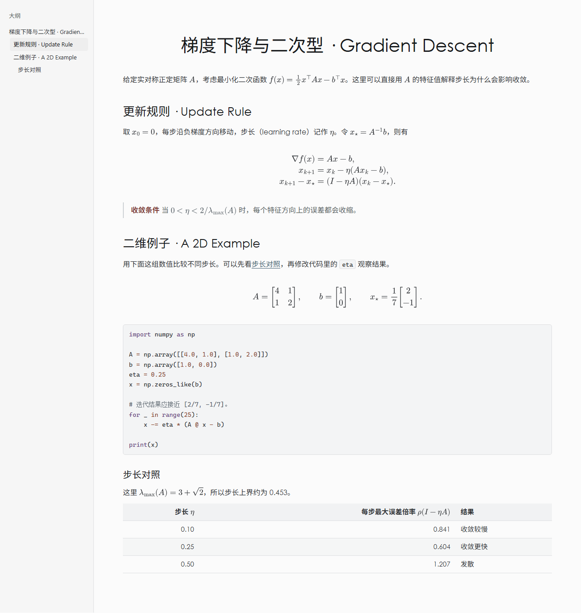

# Typora IO

一款适合数学、计算机和机器学习笔记的浅色 Typora 1.x 主题。英文采用圆润的几何字形，一级标题居中，其余标题和正文左对齐。宽屏下正文最宽 960 px，窄窗口下按编辑区收缩。 [设计参考](https://typora.io/)

## 安装

1. 下载项目。
2. 在 Typora 中打开「偏好设置 → 外观 → 打开主题文件夹」，把 [`typora-io.css`](typora-io.css) 和 [`typora-io/`](typora-io/) 资源文件夹一并放入其中。
3. 重启 Typora，在「主题」菜单选择 **Typora Io**，然后打开[《梯度下降与二次型》](梯度下降与二次型.md)试排。

## 字体

英文优先使用本机的 Century Gothic，其次使用随主题提供的 TeX Gyre Adventor。中文优先使用本机的 [Noto Sans SC](https://fonts.google.com/noto/specimen/Noto+Sans+SC)，也支持 Noto Sans CJK SC、微软雅黑 UI 和苹方。

TeX Gyre Adventor 2.501 的四个 OTF 来自 GUST 发布的原始 OpenType 包。资源文件夹中附有上游声明和字体许可。 [上游字体发布](https://www.gust.org.pl/projects/e-foundry/tex-gyre/adventor) · [GUST Font License](typora-io/GUST-FONT-LICENSE.txt) · [LPPL 1.3c](typora-io/LPPL-1.3c.txt)

## 导出

带样式的 HTML 可沿用本主题。PDF 使用 10.5 pt 正文、1.58 倍行距和最宽 178 mm 的居中版心。宽公式按页宽缩放，长代码自动换行。纸张与页边距在 Typora 的「偏好设置 → 导出 → PDF」中设置。 [Typora 实际导出的 A4 样稿](梯度下降与二次型.pdf) · [Typora 导出文档](https://support.typora.io/Export/)

## 许可证

主题代码采用 [MIT 许可证](LICENSE)。随附的 TeX Gyre Adventor 字体按其原许可分发。
