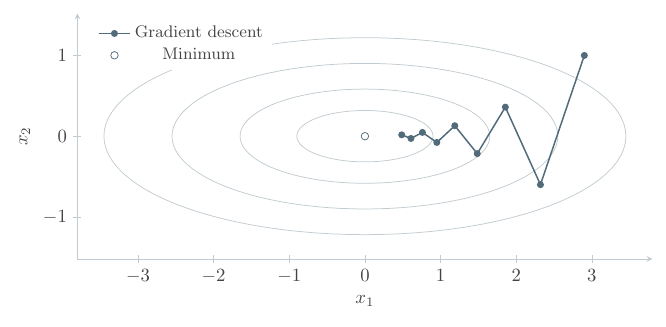

# 梯度下降与条件数

在数值线性代数和机器学习中，同一个优化问题常会同时出现在推导、代码和实验图里。本文用一个二次函数串起这些表达。先证明梯度下降的收敛条件，再比较不同特征值方向上的迭代速度，并用少量代码验证结果。

For a positive definite quadratic, gradient descent acts independently along the eigenvectors of its Hessian. The rate can be read from the spectrum, which makes this example a compact link between numerical linear algebra and optimization.

[TOC]

## 定义与定理

### 定义 · 二次型与谱

设 $A\in\mathbb{R}^{n\times n}$ 是对称正定矩阵，$b\in\mathbb{R}^n$。定义目标函数、梯度和二次型的极小点为

$$
\begin{aligned}
f(x)&=\tfrac12 x^\top Ax-b^\top x,\\
\nabla f(x)&=Ax-b,\\
x_\star&=A^{-1}b.
\end{aligned}
\tag{1}
$$

记 $\mathcal{S}_{++}^n$ 为对称正定矩阵集合，$\mathfrak{g}$ 为一个 Lie 代数。$\mathbb{R}$、$\mathcal{S}$ 和 $\mathfrak{g}$ 在行内及独立公式中各有原生字形。

$$
\mathbb{R}^n \qquad \mathcal{S}_{++}^n \qquad \mathfrak{g} \qquad
A=\begin{bmatrix}1&0\\0&8\end{bmatrix}.
$$

### 定理 · 固定步长

当 $0<\eta<2/\lambda_{\max}(A)$ 时，迭代 $x_{k+1}=x_k-\eta\nabla f(x_k)$ 从任意初值收敛至 $x_\star$。[^spectral]

#### 证明 · 将误差投影到特征向量

令 $e_k=x_k-x_\star$，并将 $A$ 写成 $Q\Lambda Q^\top$。在正交基 $Q$ 下，第 $i$ 个分量每次乘以 $1-\eta\lambda_i$。因此，由 $|1-\eta\lambda_i|<1$ 可得 $e_k\to 0$。

$$
\begin{aligned}
e_{k+1}&=(I-\eta A)e_k,\\
\|e_k\|_2&\leq\max_{1\leq i\leq n}|1-\eta\lambda_i|^k\|e_0\|_2.
\end{aligned}
$$

##### 例题 · 分段步长

若采用分阶段的步长，可以按下式记录实验设定。

$$
\eta_k=
\begin{cases}
0.2, & k<10,\\
0.1, & k\ge 10.
\end{cases}
$$

###### 核对 · 长公式与窄窗口

以下回放公式同时包含中间的迭代因子和编号。

$$
Q^\top e_4=(I-\eta_3\Lambda)(I-\eta_2\Lambda)(I-\eta_1\Lambda)(I-\eta_0\Lambda)Q^\top e_0
= \left[\prod_{k=0}^{3}(I-\eta_k\Lambda)\right]Q^\top e_0 .
\tag{2}
$$

## 实验记录

| 参数 | 含义 | 示例 |
| :--- | :--- | ---: |
| Dimension | 向量维数 | 2 |
| Iterations | 迭代次数 | 8 |
| Tolerance | 停止阈值 | 0.001 |

| 符号 | 说明 | 数值或公式 |
| :--- | :--- | ---: |
| $\eta$ | 更新步长 | $0.2$ |
| $\kappa(A)$ | 谱条件数 | $\lambda_{\max}/\lambda_{\min}=8$ |
| $\rho$ | 最大收缩因子 | $\max(0.8,0.6)=0.8$ |

*图 1 · 固定步长 $\eta=0.2$。初值为 $(2.9,1)$，圆点表示连续迭代，原点为极小值。*

~~~mermaid
flowchart LR
    A["初始点 x"] --> B["计算梯度 g"]
    B --> C{"达到容差？"}
    C -->|否| D["更新 x"]
    D --> B
    C -->|是| E["返回结果"]
~~~

> 坚持在同一页记录实验的假设、初值和停止条件。图表与推导都应使用一致的符号。
>
> 小维数的例题尤其适合手算核对。

> [!NOTE]
> 在这个例子中，最速下降的搜索方向为负梯度。

> [!TIP]
> 先输出每一步的误差范数，可以更快发现试验中的下标错误。

> [!IMPORTANT]
> 对称正定是此处证明的前提。

> [!WARNING]
> 当步长接近稳定性上界时，某些方向可能收敛得很慢。

> [!CAUTION]
> 确保步长严格小于 $2/\lambda_{\max}(A)$。

1. 准备输入。
   - 记录矩阵和初值。
   - 检查谱的范围。
     1. 计算最小特征值。
     2. 计算最大特征值。
2. 运行实验。
   - [x] 记录每一步的误差。
   - [ ] 比较预条件化前后的结果。

---

**加粗**、*斜体*、***加粗斜体***、~~删除线~~、==高亮==、下标 $x_0$ 与上标 $x^2$。HTML 行内示例为 H2O 和 m2。使用 `numpy.linalg.eigvalsh` 可计算对称矩阵特征值。[Typora Markdown 参考](https://support.typora.io/Markdown-Reference/)

## 代码样例

### Python

~~~python
import numpy as np

A = np.diag([1.0, 8.0])
x = np.array([2.9, 1.0])
for step in range(8):
    x -= 0.2 * (A @ x)
    print(f"{step + 1}: {x}")
~~~

### C

~~~c
#include <stdio.h>

double update(double x, double lambda, double step) {
    return x - step * lambda * x;
}
~~~

### C++

~~~cpp
#include <array>

constexpr auto spectrum = std::array{1.0, 8.0};
~~~

### Java

~~~java
final class Quadratic {
    static double gradient(double lambda, double x) {
        return lambda * x;
    }
}
~~~

### JavaScript

~~~javascript
const update = (x, lambda, step = 0.2) => x - step * lambda * x;
~~~

### Bash

~~~bash
for step in 0.10 0.15 0.20; do
  printf 'step=%s\n' "$step"
done
~~~

### PowerShell

~~~powershell
$steps = 0.10, 0.15, 0.20
$steps | ForEach-Object { "step={0:F2}" -f $_ }
~~~

### JSON

~~~json
{
  "experiment": "gradient-descent",
  "initialPoint": [2.9, 1.0],
  "step": 0.2,
  "steps": 8
}
~~~

### Markdown

~~~markdown
## 实验摘要

- 精度要求 **1e-3**
- [ ] 记录梯度范数
~~~

### 长代码行

~~~python
diagnostic_key = "quadratic_gradient_descent_fixed_step_size_and_symmetric_positive_definite_matrix_spectrum_for_horizontal_scroll_and_print_wrapping_verification"
~~~

[^spectral]: 在这个例子中，$A$ 对称且可由正交矩阵对角化，因此迭代矩阵的二范数等于其谱半径。
